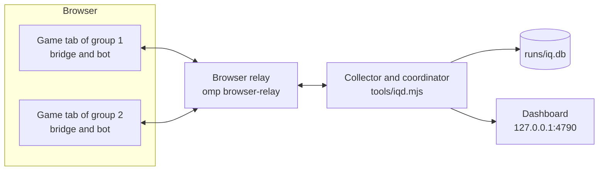

# idlequest-player

Plays an [IdleQuest](https://idlequest.net/play) account without anyone at the keyboard. IdleQuest is a browser recreation of classic EverQuest whose AutoLevel mode fights for a party of six. This project keeps many such parties leveling at once, each in a browser tab of its own: it restarts what stops, sells and banks loot, moves the groups between zones, gives each item to the character it helps most, runs quests and raids, and shows the account's progress on a dashboard.

It is for someone who wants to run it on an account of their own or change how it plays. An agent can do both, and [AGENTS.md](AGENTS.md) holds its instructions. Read [Limits](#limits) before the first run.

## How it works

The game simulates combat inside the browser client, and the server holds the account. A program that talked to the server by itself would have to rebuild the combat engine, so this project drives the real client.



- A group is six characters of the account: a leader that the tab plays and five companions in its party.
- The bridge (`src/bridge.js`) runs in each game page. It finds the client's state and its connection to the server and offers them as `window.iq`.
- The bot (`src/bot.js`) runs beside it as `window.iqBot` and keeps its group hunting.
- The collector (`tools/iqd.mjs`) reads every tab through the browser relay, keeps the history, keeps the tabs awake, signs a tab in again when the game signs it out, installs the bridge and the bot, and as the coordinator decides what each group does next.
- The dashboard shows what needs a person, how far the account is and what every group does.

## Requirements

- An IdleQuest account.
- A Chromium-based browser such as Chrome or Brave for the game tabs, on the machine that runs this project.
- [Bun](https://bun.sh) and git.
- [omp](https://omp.sh), a coding agent for the terminal, installed with `curl -fsSL https://omp.sh/install | sh`. It needs access to a language model, which its own site explains. It is ready when `omp` started in a folder answers a question. Its browser relay lets the collector reach the tabs, and an omp session opens them.
- About 1 GB of disk for the game's public content snapshot.
- About 2.5 GB of memory for each game tab.

The project has only run on macOS.

## Setup

1. Clone the repository, install and run the tests. The repository is private, so the clone needs access to it. The tests end with `0 fail`.

   ```sh
   git clone git@github.com:glockyco/idlequest-player.git   # or https://github.com/glockyco/idlequest-player.git
   cd idlequest-player
   bun install
   bun test
   ```

2. Clone the content snapshot, which the tools read for zones, enemies, drops and spells.

   ```sh
   git clone --depth 1 https://github.com/brynnb/idlequest-content ~/src/github.com/brynnb/idlequest-content
   bun tools/predict.mjs --level 5 --top 3     # prints three zones when the snapshot is found
   ```

   For another place, put `export IQ_CONTENT=/path/to/idlequest-content` into your shell's profile, so the tools, `tools/play.sh` and omp all see it.

3. Install the relay's browser extension: run `omp browser-relay install`, open `chrome://extensions` in the browser, turn on Developer mode, choose Load unpacked and pick `~/.omp/browser-relay/extension`. Nothing else needs starting. The relay starts by itself when step 6 or 7 needs it. Until then the badge on the extension's icon stays off, and it turns on once the two are connected. The [relay's own page](https://github.com/can1357/oh-my-pi/blob/main/packages/browser-relay/README.md) has the details.

4. Store the account's login where the project finds it: the email address in one file and the password in another, each on a single line. Use any editor in place of `nano`.

   ```sh
   mkdir -p ~/.config/idlequest && chmod 700 ~/.config/idlequest
   nano ~/.config/idlequest/email
   nano ~/.config/idlequest/password
   chmod 600 ~/.config/idlequest/email ~/.config/idlequest/password
   ```

   Step 6 is the first to sign in with them.

5. Describe your groups in `data/roster.json`. The file in the repository lists another account's characters, so replace it. For an account without characters, name each group's classes, the leader first, and the letter its names start with:

   ```json
   {
     "about": "Leveling groups. The first member of a group leads.",
     "groups": [
       { "id": "G1", "letter": "A", "planned": ["warrior", "cleric", "shaman", "enchanter", "magician", "bard"] },
       { "id": "G2", "letter": "B", "planned": ["rogue", "paladin", "cleric", "druid", "necromancer", "shaman"] }
     ]
   }
   ```

   A group of characters that exist names them instead, the leader first:

   ```json
   { "id": "G3", "members": ["Leader", "Second", "Third", "Fourth", "Fifth", "Sixth"] }
   ```

   A group needs a tank, a healer and a slower, and a Warrior, Rogue or Monk leads best. [docs/plans/raid-roster.md](docs/plans/raid-roster.md#roster-and-leveling-groups) gives the reasons and twelve groups that work together as a raid. Group creation picks each character's race by itself.

   `data/opportunities.json` holds quest and epic pieces that single groups hunt. On a new account remove every entry that names a `group`. Keep one only when that group of yours holds the class the piece is for.

6. Bring up each group in a tab of its own, one after another. Start `omp` in the clone and ask it, for example, "Run the JavaScript cell of README.md, setup step 6, for group G1, with this folder as the repo." The cell needs the `browser` object of omp's JavaScript cells, which opens tabs through the relay.

   ```js
   const repo = "/path/to/idlequest-player";   // the path of your clone
   const { attach } = await import(`${repo}/src/client.mjs`);
   const { createGroup, restoreGroup } = await import(`${repo}/src/group.mjs`);
   await createGroup({ browser, attach, id: "G1" });      // a planned group, about six minutes
   // await restoreGroup({ browser, attach, id: "G3" });  // a group of existing characters, about half a minute
   ```

   A call opens a game tab, signs in with the stored login, enters the world as the group's leader with the others in its party and starts AutoLevel. It ends with a line such as `G1: Aleader leads in Qeynos Hills, AutoLevel running, 12 pp`, and the tab shows the party fighting. Then bring up the next group. Groups that already play go on meanwhile.

   Before any deploy state exists, `attach` installs the working tree's bridge and bot. The collector establishes the initial deployment when play first starts.

   `createGroup` first creates the six characters, writes their names into the roster and buys each a kit of bags with the account's coin. It has only run on an account that had coin. Without coin the purchases fail and are skipped, so expect the first groups of a new account to start without bags. [docs/sdk.md](docs/sdk.md#bringing-up-a-group) says what to do when a call stops halfway.

7. Start play in a terminal of its own and leave it running.

   ```sh
   tools/play.sh
   ```

   After a minute or two the dashboard at <http://127.0.0.1:4790/> shows the groups, and `bun tools/iqd.mjs status` prints a line for each. All is well when it looks like this. The rates count the kills of the last half hour, so a group that just started shows them after its first kills, and `last kill` says how long ago its last one was.

   ```
   iqd 15:06:11  daemon running (pid 76146, every 30s, last cycle 12s ago, relay up)
   Page code: commit 18cdbba since 14:00:42, installed in every tab
   Sessions
     G1 Leader L3 40% Qeynos Hills | fight 4s 104 kills/h 0.02M xp/h idle 2% last kill 51s | heap 600MB 15%
     G2 Other L2 10% Misty Thicket | approach 6s 90 kills/h 0.01M xp/h idle 5% last kill 20s | heap 580MB 14%
   ...
   Needs you (0)
   ```

## Run

`tools/play.sh` runs the browser relay and the collector in the foreground. It starts the collector again when it exits or finishes no cycle for a quarter of an hour, and restarts a relay that exits.

```sh
tools/play.sh                 # play until Ctrl-C
bun tools/iqd.mjs status      # every group in a line, and what needs a person
bun tools/iqd.mjs help        # the collector's other commands
```

- Ctrl-C stops the collector and the relay, not the game. A tab in front goes on hunting by its bot, and hidden tabs slow down until their fights stop ending. To stop the account from playing, close the game tabs.
- To start again, run `tools/play.sh`. Tabs that stayed open pick up by themselves. For each closed tab, have omp run the cell of step 6 with `restoreGroup` and the group's id.
- Keep the browser open while it plays. The game tabs need not be in front.
- Do not reload or navigate a game tab, and do not open DevTools in one. A reload signs the game out, which the collector repairs in a minute or two.
- Leave the browser's notice that it is being debugged alone. Dismissing it cuts the tab off from the relay.
- The game tabs use most of the machine's memory. Run simulations and other heavy work one at a time.

To add a group, add it to `data/roster.json` and bring it up as in steps 5 and 6. [docs/collector.md](docs/collector.md) describes the collector, its commands, the dashboard and the coordinator. [docs/runbook.md](docs/runbook.md) describes how to act in a tab by hand when something is stuck.

### Deploying page code

Once deploy state exists, the tabs run the bridge and the bot of the deployed commit. Before that, `attach` installs the working tree, as in setup step 6. To change the deployed page code, commit and deploy an edit of `src/bridge.js` or `src/bot.js`:

```sh
bun tools/iqd.mjs deploy --canary G7   # HEAD in group 7 first, the others keep their code
bun tools/iqd.mjs deploy               # HEAD in every group
bun tools/iqd.mjs revert               # every group back to the commit that ran before this one, also after a canary
```

`deploy` takes a commit as its first argument and runs `bun test` first. The tests run on the working tree, so it refuses while the tree's page files differ from the commit's. `--untested` skips both. The collector installs the code within about two minutes, outside raids. A running task delays installation only while its page is in the world and the task is younger than `PAGE.taskWaitMin` in `tools/lib/page.mjs`. `iqd status` names the deployed commit and the groups that do not run it yet. Before the first deploy the collector deploys the commit at HEAD.

The collector's own code under `tools/` is the working tree's and loads when the collector starts. After changing it, stop `tools/play.sh` with Ctrl-C and start it again at once.

## Limits

- The project plays as the game's own client could. It sends only requests the client can send and gains no items, XP or coin outside normal play.
- Its characters trade with no other player, send no messages and join no guild.
- When the game or its developer warns about automation or blocks it, stop.
- The repository holds data extracted from the game client and the names of an account's characters. Keep a copy of it private.

## Rules for changes

- `bun test` passes. The tests in `tests/` run the bot against a fake page, because a loop in the real page freezes and then crashes the game tab.
- Never assign to `socket.onJson` or another callback slot on the game's objects. The client's own packet dispatch lives there, and replacing it leaves the world stuck on the loading screen. Wrap instance methods, as `src/bridge.js` does.
- Never call `warpPlayerToCombatEntity` or `teleportPlayerToEQPosition`. They are debug functions that a player cannot use.
- `.re/` holds downloaded copies of the game client and `runs/` the collector's data. Neither is committed.
- Check a change to how the account plays in a game tab or in the collector's data, and take it back when the numbers get worse. [docs/tools.md](docs/tools.md#measuring-play) has the tools that compare.

## Troubleshooting

- A tool fails with `ENOENT ... /data/zone` or cannot read a table: the content snapshot is missing or elsewhere (step 2).
- `iqd status` says `daemon NOT STARTED`, `STOPPED` or `NOT RUNNING`: play has not started, stopped cleanly, or no recent cycle finished. Check the terminal running `tools/play.sh` for what the collector does.
- `iqd: another iqd run is active`: one collector runs per data directory. Stop the other one.
- `status` shows `relay DOWN`: the collector has no connection to the browser. Check that the extension is loaded in `chrome://extensions` and that its badge is on.
- A group shows as `GONE`: the collector cannot reach its tab. When the tab is still there, the browser's debugging notice was dismissed or DevTools is open in it. When it is not, or it stays `GONE` for five minutes, bring the group back in a new tab with `restoreGroup` (step 6) and close the old tab in the browser.
- A tab stays at the login form: the login files are missing or wrong (step 4). After "Too many login attempts" the collector waits a minute by itself.
- The world sticks on the loading screen after a change to the bridge: something replaced `socket.onJson` or another callback slot. Take the change back, bring the group back with `restoreGroup` and close the stuck tab.
- AutoLevel stays off in a tab: `bun tools/iqd.mjs page <group> 'window.iqBot.report()' --read` shows a pause with its reason and end, or that the bot is turned off.
- The game client changed and the bridge no longer finds something: [docs/runbook.md](docs/runbook.md#after-a-client-update).

## Where to read more

- [docs/collector.md](docs/collector.md): the collector's commands, the dashboard, the coordinator, the page supervisor and the attention items.
- [docs/runbook.md](docs/runbook.md): operating a tab by hand, the bot's alerts and a client update.
- [docs/sdk.md](docs/sdk.md): driving one tab from a script.
- [docs/tools.md](docs/tools.md): the tools for zones, drops, gear, XP predictions, raid simulations and measuring play.
- [docs/guide.md](docs/guide.md): how to take an account from new characters to a raid roster.
- [docs/client-internals.md](docs/client-internals.md): how the game client and its protocol behave.
- [docs/plans/](docs/plans/): the designs, with their measurements. [docs/plans/controller.md](docs/plans/controller.md) is the one the parts converge to.
- [docs/goal.md](docs/goal.md): what the work on this account aims at. [diary/](diary/) has an entry per working session.
