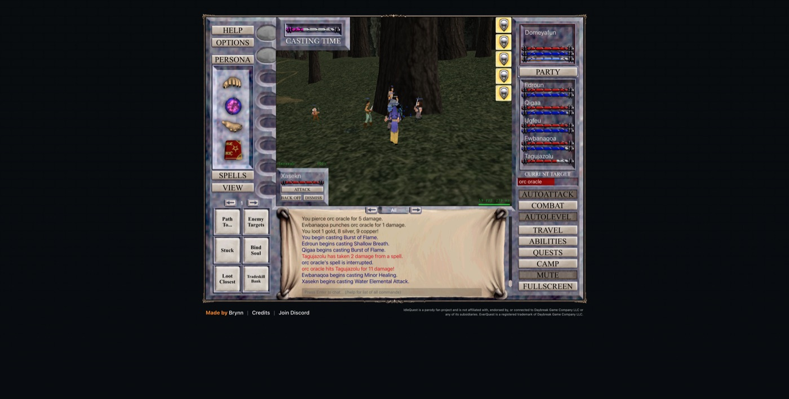

# 2026-11-06 (evening): everyone matters, and why we kept waiting

## Six characters, one fight

Domeyafun the Magician, a Dwarf Warrior, a Dwarf Cleric, a Half-Elf Bard, a Barbarian Shaman and a
Gnome Enchanter now fight as one party in Greater Faydark. Domeyafun is level 6 and the five
others are level 3. Each kill splits the XP by level, so Domeyafun gets about twice what each of
the others gets, but they need much less XP per level and are catching up.

## I told you the alts had nothing, and I was wrong

My status view read the alts' gear before the game had loaded it. They were already wearing
things the party had looted: a cloth shawl and a two-hand sword on the Warrior, a spear and a belt
on the Shaman, a short sword on the Bard. The Cleric still has nothing. The game decides who gets
each drop on its server. I turned on the option that shares drops with the alts, and it works.

## Why the party stands around

The game waits until every member, pets included, has full health and full mana before it walks to
the next monster. My recordings showed those two steps never overlap, so about a third of the time
is spent standing still and another third walking. The code is clear about why: the same strict
check guards AutoLevel, the Enemy Targets list and even the Auto Attack button.

One thing does skip it. If you pull with a spell, the fight starts at once and the whole party
joins. I tested it by hand. A custom controller could pull that way and let the party recover
while it walks. That is a bigger project, so first I am trying the cheap fix: stop the healers and
the Enchanter from casting damage spells that burn their mana for almost nothing.

## A mistake worth keeping

For about 27 of the last 57 minutes the party was not fighting at all. Some of that was a one-off
trip to look at 20 zones and some was my experiments. Nobody watching the game would call that
efficient, and you said so. Anything that needs the party to stand still now runs inside a helper
that always starts AutoLevel again afterwards.
