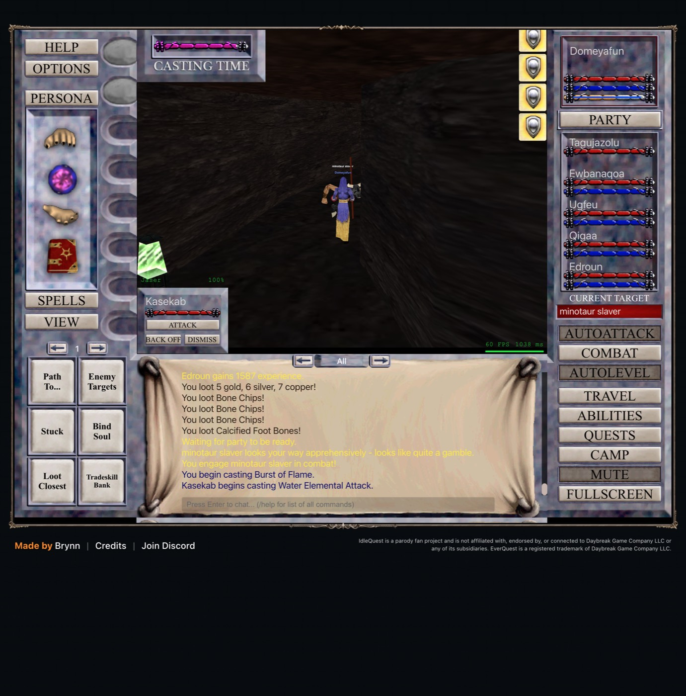

# 2026-11-06 (late): harder enemies, a reload, and a second group that is not there yet

Domeyafun is level 9 and the five others are level 8. All six are in Steamfont Mountains, and
nobody is hurt.

## We were fighting enemies that were too easy

You pointed out that kills were quick and everyone sat at full health. I had never raised the
level cap above two levels over Domeyafun, because the only deaths so far came from a much
weaker party. So I tested it, with a watchdog that would drop back to the old settings if anyone
fell under 30% health.

| Setting | XP per hour | XP per kill | Median seconds to kill | Lowest health seen |
|---|---|---|---|---|
| Blue to Yellow, up to 2 levels above (before) | 201k | 1,472 | 9.8 | not recorded |
| White to Red, up to 3 levels above | 351k | 2,121 | 9.4 | 87% |
| White to Red, up to 4 levels above | 305k | 2,299 | 10.1 | 84% |

Each block is four to five minutes in one zone, so these are hints and not settled numbers. Three
levels above is the best so far. At four levels above the XP per kill goes up but the party spends
more time walking, because Steamfont has few enemies above level 11.

The game links the two settings. Setting the level cap also changes the highest colour it
allows, and setting the highest colour resets the cap. I now set them together.

## How strong an enemy really is

I wrote `tools/mobs.mjs` to list a zone's enemies from the game's data: HP, damage per second,
armor, whether it casts, and its special abilities. In that data HP, damage and armor depend only
on level. A level 14 enemy has 336 HP and about 5.5 damage per second. A level 9 enemy has 171 HP
and 3.8. A live level 10 target showed the same 200 HP as the data, so I trust it.

The numbers to watch from now on are the lowest health anyone reaches in a block and the median
time to kill, next to XP per hour. Damage taken per kill is the next measure to build.

## The reload and the second tab

Opening a second tab with a URL navigated the first tab instead, and the game logged out. I had
to ask for a new sign-in and recruit the five companions again. Settings, spells and gear stayed.
It cost a few minutes and no progress.

The second tab for a second group does not work yet. The browser relay does not list a tab that
was opened and signed in by hand, and it closed a tab that it had opened itself right after the
login redirect. Until that is solved, group B waits. The account's character slot limit is still
unknown.

## Recorder fix

The recorder numbers its rows from 1 again after a page reload, so the exporter skipped about
1,600 rows after the reload. Rows now carry a page session id, and the exporter keeps a cursor per
file. The skipped rows were recovered.

## Research notes

Two notes are in `docs/plans`. `magician-epic.md` is the full route to the Magician epic, checked
against the game's data. `systems-research.md` has what the wiki and the client prove about
Alternate Advancement, raids and money, and says which facts are still unknown.
