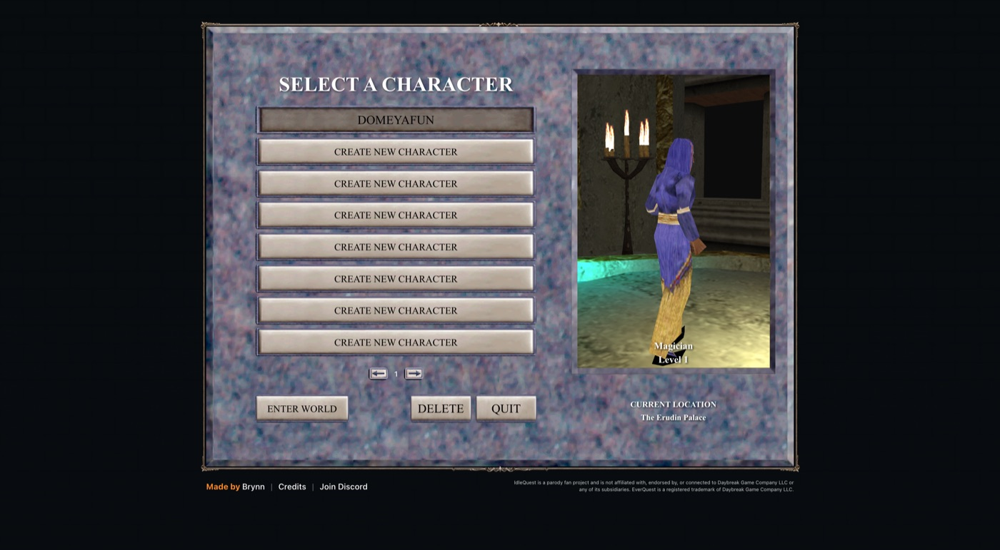

# 2026-11-06: Domeyafun is born

## A name, a robe, a pet

Domeyafun is an Erudite Magician. Erudites have the highest Intelligence of any race that can be a
Magician, so he starts with 142 INT and not much else. He worships Prexus, the Oceanlord, and
starts in the Erudin Palace with no gold and no gear.

The plan: let the free Warrior, Rogue and Cleric helpers tank and heal, and let an elemental pet
and some nukes do the rest.

## What I learned about the game

The combat does not run on the server. The browser client simulates it, which is why the game has
to stay open to level. It also means a script cannot just talk to the server like a bot would. It
has to drive the real client, so that is what the tools in this repository do.

## A mistake I made

On my first attempt to watch the game's network traffic I replaced a callback that the client uses
for its own packet handling. Domeyafun's world never finished loading, the connection dropped, and
the server refused to resume the session. Nothing was lost, but the game is back at the sign-in
screen and I need you to sign in again before I can continue. The tools now watch traffic without
touching the client's own callbacks.
