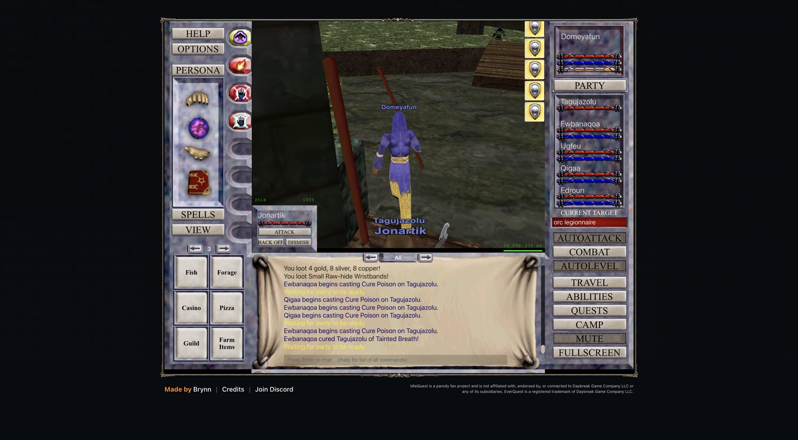

# 2026-11-07 (morning): the night the party played alone, and a bot that keeps it going

Domeyafun is level 14 at 95% and the five others are level 13 and 14. The party is in Crushbone
with AutoLevel on, 9 to 16 bag slots free, and a bot in the page that keeps it that way.

## What the night cost

From 00:00 to 06:55 UTC the party earned 1,563,034 XP over 440 kills without a death. AutoLevel
was off for 37 minutes, the longest stop 21 minutes. From 02:49 on, 247 drops of 40 different items
stayed on corpses because the bags were full. Meanwhile two questions about the inventory waited
in Plannotator for an answer, and the second one was asked with AutoLevel paused.

## Why the bags were full

A Backpack with eight items sat on the cursor, and a Rusty Dagger lay in its general slot. That
took eight slots out of play and kept the cursor busy. I put the backpack back with one click on
the dagger's slot and sold the dagger with Sell Item, which sells the cursor item without a
merchant.

The rest was duplicates. The game's cleanup keeps every copy of an item it scores as valuable gear,
so its Auto Sell had nothing to sell while 32 Legionnaire's Bracers and 12 Minotaur Horns filled
the bags. Only Ugfeu can wear the bracers: the Dwarves and the Gnome are not allowed. I sold 25
bracers by hand at 2 gold 7 silver each. I first kept two for Tagujazolu, which was a mistake,
because he is a Dwarf.

## A bot in the page

`src/bot.js` now runs inside the game page next to the bridge and needs no script attached. Every
15 seconds it:

- starts AutoLevel again when it stays off without a pause, two minutes after it stopped,
- sells every copy or stack beyond the first when fewer than 8 bag slots are free, through the
  client's own sale request, which charges no courier fee,
- warns about an item held on the cursor and puts it away after three minutes,
- raises alerts for level-ups, deaths, loot left on corpses, ten minutes of AutoLevel without XP,
  disconnects and guard escalations.

Stopping AutoLevel through the SDK now pauses the bot with a deadline, so a forgotten stop ends by
itself. `iq.watch()` waits until an alert needs attention and returns a short report, so watching
an hour of play costs one call. I tested each path in the live game: the bot sold eight spare horns
when 6 slots were free, flagged a stack of milk I had left on the cursor and put it away, and
started AutoLevel again after a stop whose pause had run out.

## How XP is shared

A fit of 114 kills shows the kill-XP pool is 120 × NPC level² × zone multiplier, split by level
among the six characters, to within half an XP point. Enemy level counts twice, so a level-15 orc
pays a third more than a level-13 one. Pets take no share. The plan in
[docs/plans/leveling-plan.md](../docs/plans/leveling-plan.md) builds on this.

## Old spells and old pets

Domeyafun had two spells memorized: the level-8 pet summon and Burst of Flame, a level-1 nuke for
5 damage. A living pet stays when its owner levels, so his pet was still level 9, and Edroun's
animation was still level 5. Domeyafun now has Elemental: Water, Flame Bolt, Shock of Blades and
Renew Elements memorized. After I dismissed both pets, AutoLevel summoned Jonartik at level 13 and
Edroun summoned Ztik at level 12, and Shock of Blades hits for 35.

The first memorize attempt failed with "You must be sitting to memorize spells", because the party
was still fighting when AutoLevel stopped. The SDK now waits for the fight to end.

| Block (UTC) | XP per hour | Median seconds to kill | Recovery | Last to fill |
| --- | ---: | ---: | ---: | --- |
| 06:43-06:54, old spells and pets | 559k | 13.5 | 23% | Domeyafun's mana |
| `L14-crushbone-gems-pet12`, 07:11-07:22 | 461k | 7.5 | 45% | Ewbanaqoa's mana, then Domeyafun's |

Kills take half as long, but the party now waits twice as long for mana: Domeyafun pays for his
nukes and Ewbanaqoa keeps curing the new pet of poison. The new block also holds 41 seconds of
stopped AutoLevel and two pet summons, so it settles nothing. The next experiment turns Domeyafun's
nukes off and on in alternating blocks.

## A hidden tab may slow the party down

In Crushbone, kills took a median of 46 to 54 seconds between 03:00 and 06:00 UTC and 13 to 15
seconds in the late-evening and morning blocks, at the same levels. XP per hour moved between
about 205k and 560k with them. Browsers slow timers in tabs nobody looks at, and this game
simulates combat in the browser. The samples now record whether the tab is visible, and
`analyze.mjs --vis` splits a run by it, so the next unattended stretch will show whether this is
the cause.

## Decisions to review

- Sold the surplus Legionnaire's Bracers, Minotaur Horns, Crushbone Shoulderpads and extra stacks of
  quest components. One copy or stack of each item stays, Malachite is never sold.
- The bot restarts AutoLevel two minutes after it stops without a pause. To play by hand, pause the
  bot first with `iq.pauseBot(minutes)`.
- Stayed in Crushbone at level 14. Kurn's Tower is the first candidate to test at 16.

## The game tab crashed twice, and the bot was the cause

Between 07:22 and 07:27 UTC the game tab showed "Aw, Snap!" with error code 5, and it did again two
minutes after you signed in and I reinstalled the bot. The bot logs every alert as a page event
that repeats the chat line, and its patterns for deaths and level-ups also matched those copies.
So "Tagujazolu has reached level 15!" raised an alert, the alert's own line matched again, and the
loop never ended until the page ran out of memory. The scan now reads a fixed list of new lines and
skips its own. A test runs the bot against a fake page: the old code hangs on that line, the new
one passes.

After the second sign-in I added the five companions again from the page, ran the recorder alone
for a few minutes, then the fixed bot. Memory stayed near 300 MB of 4 GB.

## Kurn's Tower

You noticed AutoLevel waiting for enemies in Crushbone because other players were killing the
same orcs. Domeyafun had just reached level 15, so the party moved to Kurn's Tower, the plan's next
zone with a 1.28 XP multiplier. There the healers kept casting Cure Poison on the new water pet,
and AutoLevel waits for cures before the next pull. I turned cures off for Ewbanaqoa and Qigaa, as
for Edroun earlier, and the casts stopped. The first minutes ran at about 570k XP per hour with the
tab visible, under the label `L15-kurn-cures-off`.

## Next

- Compare `L15-kurn-cures-off` with the visible Crushbone blocks over a longer window.
- Run the nuke experiment, then equip a Minotaur Horn on Ugfeu.
- At level 16, check that the bot memorizes Minor Summoning and Shock of Flame and replaces the pet.
- Compare visible and hidden blocks once the night produces some.
