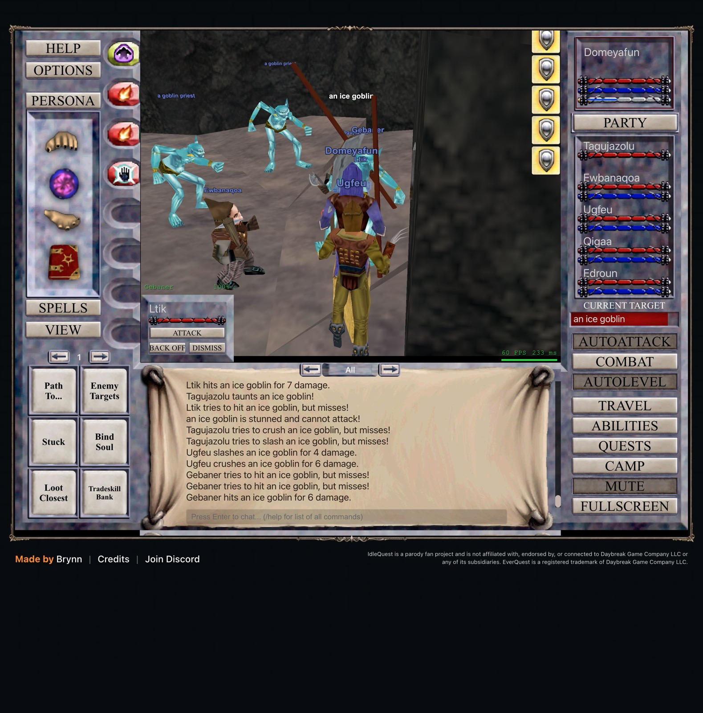

# 2026-11-07 (late morning): Permafrost and short probes

Domeyafun is level 19 and the five others are 18 and 19. The party hunts ice goblins in the Permafrost Caverns.

## Leaving Kurn's Tower

At level 18 Kurn's Tower had stopped being worth it. Over 90 minutes there were no deaths, no guard escapes and nobody below about 60% health, but most kills were level 12 to 15. XP per kill grows with the square of the enemy's level, and the zone has few enemies above 16. The offline zone ranker put Permafrost Caverns first for levels 18 to 20: a zone multiplier of 1.44 against 1.28, and about 120 goblins of levels 16 to 21 against 51.

The first move failed. Stopping AutoLevel lets the last fight end, and the game then auto-loots the corpse, which closes any open window, including the Travel window that had just opened. `travelTo` now waits until the chat has shown no loot for four seconds and opens the window again if it closes.

## Three kinds of standing still

The party stood idle three times this morning, each time with AutoLevel switched on:

- After "No usable route. Recovering near Burynai excavator." the game found no new target and stayed idle for 344 seconds. In the 19 other recoveries of those four hours it found a target within a second.
- AutoLevel kept saying "Waiting for party to be ready." for two minutes while everyone was at full health and mana. Auto-attack stays off while it waits, which is what it looked like.
- Domeyafun's own tactics are kept in a different store from his companions'. The earlier nukes on/off comparison therefore never turned his nukes off, and its result was meaningless.

The bot now restarts AutoLevel 45 seconds after a route recovery that finds nothing, after 30 seconds of a readiness wait with everyone full, and after 3 minutes out of combat without XP. The readiness rule fired once in the first half hour. `iq.setTactic` now writes the active character's tactics to the right store.

## Five-minute probes

Each probe ran 5 minutes in the same part of Permafrost at level 18, with the tab visible.

| Label | Setting | Kills | XP per hour | Lowest member |
| --- | --- | ---: | ---: | ---: |
| `P-perma-nuke-off` | Domeyafun's nukes off | 14 | 1,864,000 | 51% |
| `P-perma-nuke-on` | nukes on | 13 | 1,880,000 | 75% |
| `P-perma-nuke-off-2` | nukes off | 11 | 1,604,000 | 72% |
| `P-perma-nuke-on-2` | nukes on | 15 | 1,424,000 | 79% |
| `P-perma-mincon10` | nukes on, white or harder targets only | 16 | 2,121,000 | 69% |

The rates are Domeyafun's share of the kill XP. Two probes of the same setting differ by up to 15%, so the nuke pairs settle nothing about XP. Nukes stay on because the party's lowest health was better with them. Skipping blue targets gave the best probe, so AutoLevel now uses con 10 to 13.

The XP needed per level still follows 1,000 × (level - 1)³. Level 19 runs from 5,832,000 to 6,859,000.

## Next

- Keep probing in five-minute steps whenever the level, zone or spells change, rather than waiting for long blocks.
- Inventory: Auto Bank moved 16 stacks of crafting ingredients to the tradeskill bank for free. What fills the bags now is single copies of cheap weapons, which the bot's duplicate-only selling does not touch.
