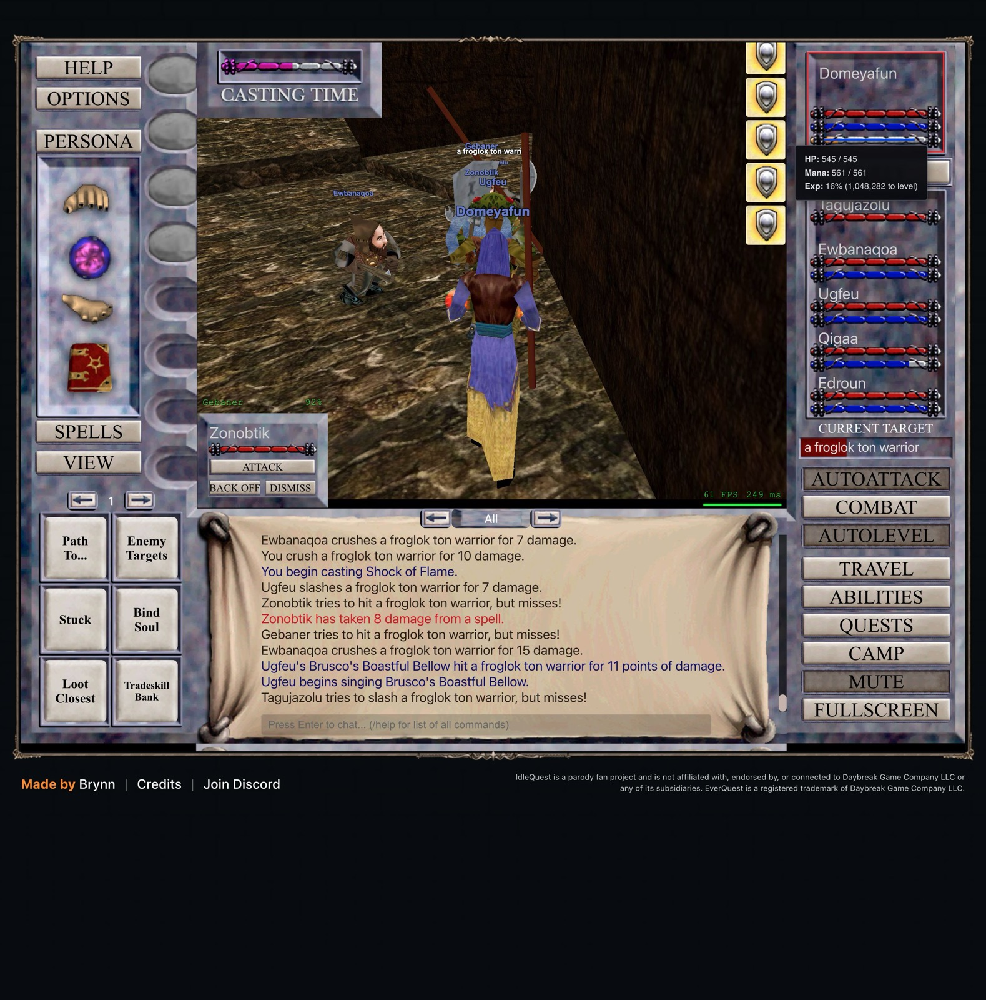

# 2026-11-07 (midday): Guk, failing dispels and a guard that looped

Domeyafun and Tagujazolu are level 21 and the four others 20. The party hunts frogloks in the City of Guk.

## Why the party stood still between pulls

The party stood around for up to a minute after some kills while Edroun cast Cancel Magic over and over. The client's readiness wait ends only when everyone is full, nobody is rooted, and no cure or dispel was cast in the last pass. Its dispel roll succeeds with 32% plus 7% per level the caster is above the effect's caster, or minus 2% per level below, clamped to 10-100%. Against Snares from level 21 to 24 frogloks, Edroun at 19 failed most attempts, and the party waited until the Snare wore off.

In 14 minutes the 4 waits with a dispel averaged 48 seconds against 11 seconds for the other 15, and 5 of 15 Cancel Magic casts removed anything. My earlier analysis had counted this as "Edroun:mana" recovery, because his mana went into the failing casts. `analyze.mjs` now groups each wait between pulls by cure, root or neither. Edroun's cures are off again.

Root waits remain. Froglok shamans cast Root about once a minute, and a root wait averages 25 seconds. A dispel would take about 34 seconds on average at Edroun's 26% chance, so waiting it out is faster.

## The guard

At level 20 a level-30 froglok tsu shaman in Guk sent the party to Steamfont, the retreat zone I had set at level 12. Meldrath the Malignant (level 35) triggered two more escapes there. The third escape replaced the limits with fixed "safe" ones that left nothing to fight, and AutoLevel stopped.

I first made the guard re-enter the current zone. That brought back a loop: AutoLevel picks the nearest target, which in Guk is a vis shaman beside the tsu shaman at the zone-in, so the guard escaped ten times in seven minutes. The guard now puts every mob of the escaped fight on the client's own skip list for ten minutes (`deferAutoLevelSpawn`, the list the client uses for spawns it cannot reach). After the next escape the party killed seven frogloks in four minutes without another one.

The guard no longer judges zones by how often it escapes. An escape costs about 13 seconds, and `analyze.mjs` reports escapes and their cost next to the XP per hour. When "No available enemies found in this zone" repeats, the bot restores limits the guard tightened, lowers a raised minimum con, and otherwise raises a `noEnemies` alert.

## Nukes, decomposed

| Label | XP per hour | Kills | Median kill | Domeyafun's mana recovery | Seconds per kill | Root waits |
| --- | ---: | ---: | ---: | ---: | ---: | ---: |
| `L20-guk-fixed` (nukes on) | 1,591,520 | 34 | 9.8 s | 109 s | 14.4 | 98 s |
| `L20-guk-nuke-off` | 1,779,019 | 32 | 12.9 s | 6 s | 16.7 | 25 s |

Seconds per kill counts fighting, recovery and walking. Both blocks ran 10 minutes in the same area. The nukes-off block had the better XP per hour because it drew fewer root waits and frogloks worth more XP (9,250 against 7,788 per kill). Per kill, the nukes save more fighting time than their mana costs, so they stay on.

The XP per level still follows 1,000 × (level - 1)³. Level 21 runs from 8,000,000 to 9,261,000.

## Decisions to review

- Edroun's cures are off. Turn them back on only if the "Between pulls" lines show that a cure would save time.
- The guard's level trigger (8 levels above the leader) is a guess. A supervised fight against a level-30 tsu shaman would show whether this party at 21 can take one.
