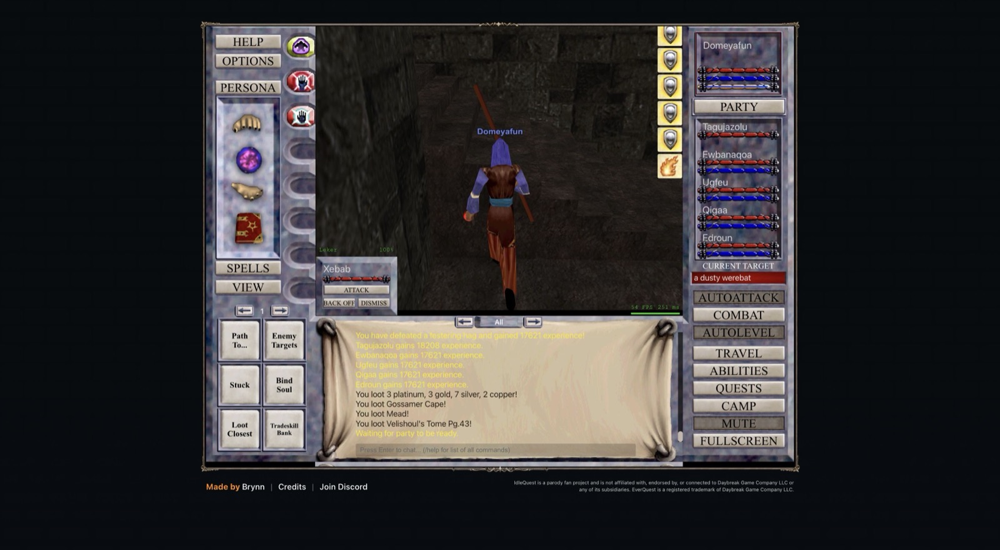

# 2026-11-07 (evening): zone predictor, companion bags, Nullify Magic dispels and level 30

Domeyafun is level 30 (77%), Tagujazolu 31, and Ewbanaqoa, Ugfeu, Qigaa and Edroun 30. The party hunts in the Estate of Unrest at 2.5M to 2.6M XP per hour per character, with 1,270 pp in cash after buying all level-29 and level-30 spells and five Coldain Velium weapons in Thurgadin.

## Predicting XP per hour and spell policies (`tools/predict.mjs`)

- `tools/predict.mjs` computes expected XP per hour per character for every zone from the content snapshot's spawn tables, NPC HP and damage, and the client's hit, mitigation, resist and recovery formulas. Calibrated against Permafrost (level 24) and City of Guk (level 21), it matches both within 2% on XP per hour and 10% on kills per minute.
- Harder enemies inside a zone do not pay more per hour. XP per kill grows with enemy level squared, and enemy HP grows at almost the same rate, so XP per second of fighting is nearly flat across enemy levels. The zone experience multiplier and recovery time set the rate.
- Added `--spells` to `tools/predict.mjs` to compare Magician nuke gem counts (0, 1, 2) and support-caster offensive tactics. Every Magician direct-damage spell in `spells_new` has `recast_time` (2.25 s) at or below `recovery_time` (2.5 s), so the highest-tier nuke (`Shock of Spikes` at 24 to 33, `Cinder Bolt` at 34 to 43) is already off cooldown when spell recovery finishes. Memorizing a second, older nuke (`Bolt of Flame`) only causes the combat AI to cast the weaker spell half the time. `nukeGems` is now 1 (`Greater Summoning: Water`, `Shock of Spikes`, `Renew Summoning`).

## Guard ambush fix and automatic band rotation

- At level 28 in Permafrost, outer goblins turned green and AutoLevel pathed deeper toward a goblin priest past level 47 to 50 ice giants. Because the giants aggroed on the way before the priest was engaged, `guardLeave` deferred only `engagedMobs` (the giants) and left the priest eligible, repeating the same walk and escape 189 times over 25 minutes until the 20-minute XP-rate watcher rotated to Lair of the Splitpaw.
- `guardLeave` now defers the active and approached pull-target spawn IDs alongside `engagedMobs`. `bot.js` also rotates immediately after 4 guard escapes in 10 minutes (`rotateEscapes: 4`) and updates `rotation` automatically on each `levelUp` from `BAND_ROTATIONS`.

## Companion bags, account-wide tools and Thurgadin weapons

- `Auto-Upgrade Companions` moves each replaced item into the recipient's inventory. Once Tagujazolu's and Ugfeu's initial slots filled with old gear, further hand-downs failed with "That character has no inventory space for the replaced item."
- Cycled through all five companions, sold their old gear, packed their starter items into their starter `Backpack*`, and bought 8-slot Backpacks from Vall Stonewisp in Erudin Palace so every party member has 56 to 64 bag slots.
- Audited all 24 built-in macro actions in `engine.pretty.js` (`docs/client-internals.md`). Added `iq.manageMoney` to collect coin across all account characters, and updated `iq.giveItem` to use `stores.character.getState().moveItemToSlot` and support ungrouped account characters.
- Used `Inventory Search` across the account and found `Iksar Berserker Club` (7/18, ratio 0.39) sitting inside Ewbanaqoa's bag from Kurn's Tower. Moved it into Tagujazolu's main hand (+71% main-hand base DPS), and travelled to Hakon Brightsteel in the City of Thurgadin to buy three `Coldain Velium Rapier`s (6/23, Magic) for Tagujazolu's offhand and Ugfeu's both hands, a `Coldain Velium Great Staff` (10/36) for Qigaa, and a `Coldain Velium Morning Star` (9/38) for Ewbanaqoa.
- Added `--party [roster.json]` to `tools/gear.mjs` so whole-party upgrade planning (merchant buys, in-rotation drops and high-gain side drops) can be re-run at any level.

## Out-of-combat root dispels (`Nullify Magic`)

- Tracing `Nz` (`BQ.pretty.js:24156-24322`) explained why 96-second `Enstill` roots from Unrest's festering hags were taking 50 to 90 seconds:
  1. `Nz` never casts Bard songs, so keeping `Alenia's Disenchanting Melody` (727) in `DISPELS` caused `casters.slice(0, 2)` to enable Ugfeu (Bard) instead of a real dispeller.
  2. `Nz` iterates companions in party order and locks the rooted target (`Rn`) during each cast. Enabling both Ewbanaqoa (#3) and Qigaa (#5) caused them to alternate `Cancel Magic` (mod 1, 32% to 39% chance) and starve Edroun (#6), who learned `Nullify Magic` (id 49, mod 4, 60% dispel chance) at level 29.
  3. `Nz` sorts dispels by `mana / chance`, which picks `Taper Enchantment` (5 mana, mod 1) over `Nullify Magic` (50 mana, mod 4) unless weaker dispels are in `excludedSpellIds`.
- `dispellers` in `src/bot.js` now excludes weaker dispels (while preserving `mez: true`) and ranks dispellers by `level + mod` descending (`Edroun` 60% + `Ewbanaqoa` 39% = 75.6% combined dispel chance per cycle). Over the next 30 minutes in Unrest, all four `Enstill` roots were cleared in 8, 10, 16 and 30 seconds (mean 16 s), and XP per hour rose to 2.59M.

## Level-30 XP curve and epic pieces

- Level 30 runs from 24,389,000 (`1000 * 29^3`) to 29,700,000 (`1.1 * 1000 * 30^3`), requiring 5,311,000 XP (2.03 times level 29's 2,437,000 XP, because the 1.1x hell-level multiplier applies to cumulative XP at the 30 to 31 boundary).
- Epic pieces collected in bags so far: `Heart of Frost` (Warrior epic, from Permafrost) and `Torn Page of Magi'kot pg. 2` (from Unrest).
