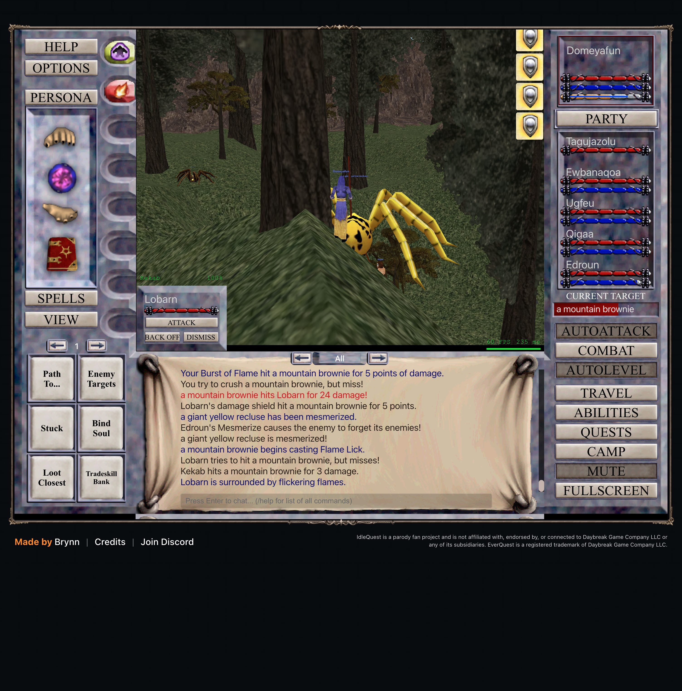

# 2026-11-07: spells caught up and the Enchanter stops wasting mana

Domeyafun is level 10. The other five characters are level 9, and AutoLevel is running in Steamfont Mountains.

## Companion spells

The game repeatedly reported missing merchant spells, but the old SDK only bought them when attached and actively clicking macros. The bridge now watches the game's own reminder and sends the same spell-purchase requests as the macros. It stays active inside the page while no script is attached.

A real reminder triggered the purchase of 11 companion spells for 33pp. The game confirmed the purchase, and AutoLevel kept running. A later manual check found no missing spells and spent nothing. The SDK records each result as a `chore` event.

## Cancel Magic between fights

The screenshot shows Edroun repeatedly casting Cancel Magic on Tagujazolu while AutoLevel waits for the party to be ready. The game enables automatic cures and dispels by default. That made the Enchanter spend mana outside combat.

I turned off the `cure` tactic for Edroun only. In a live check, Edroun stayed at 191/191 mana through a fight and the next readiness wait. AutoLevel remained running. This also disables Edroun's automatic cures, so I will restore it if the party needs those cures later.

## Follow-up block

Over the next 4.9 minutes, Edroun stayed at 191/191 mana and no further Cancel Magic or dispel
messages appeared. AutoLevel stayed on, the party's lowest observed health was 90%, and Domeyafun
gained 20,598 XP. The analyzer measured 303,620 XP/hour, with 22.6% of the block spent recovering.
That recovery was Domeyafun's mana for 58 seconds and the Cleric's mana for 18 seconds, not Edroun's.
Turning off Enchanter cures stopped the wasted casts, but this short block does not show an XP-rate
improvement. Another reminder also bought 10 companion spells for 30pp.

## Current party

Domeyafun is level 10 with 879,547 of 1,000,000 XP. All five companions are level 9, AutoLevel is
running, and every character is at full health.
