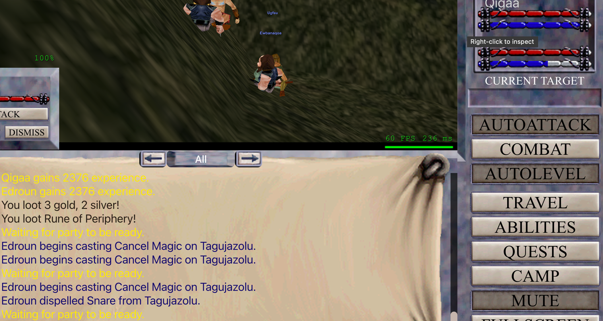
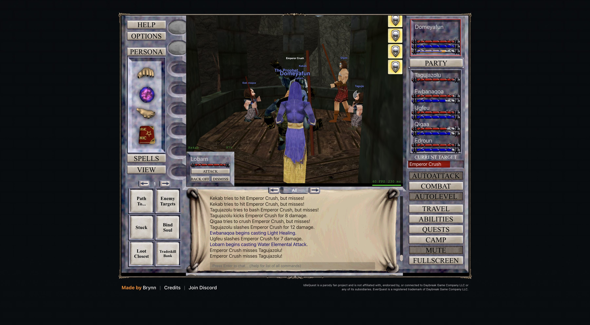
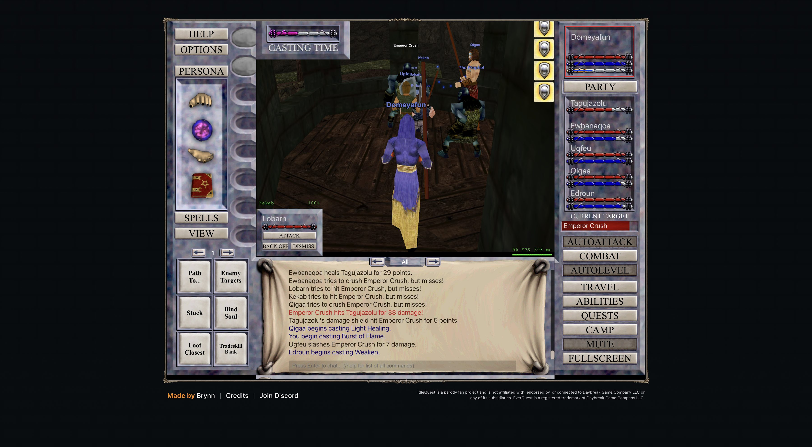
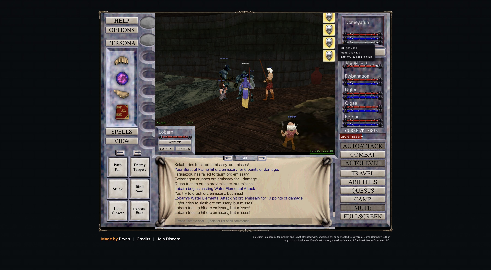
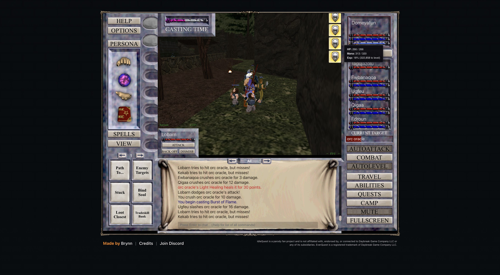

# 2026-11-07: spells caught up and the Enchanter stops wasting mana

Domeyafun is level 10. The other five characters are level 9, and AutoLevel is running in Steamfont Mountains.

## Companion spells

The game repeatedly reported missing merchant spells, but the old SDK only bought them when attached and actively clicking macros. The bridge now watches the game's own reminder and sends the same spell-purchase requests as the macros. It stays active inside the page while no script is attached.

A real reminder triggered the purchase of 11 companion spells for 33pp. The game confirmed the purchase, and AutoLevel kept running. A later manual check found no missing spells and spent nothing. The SDK records each result as a `chore` event.

## Cancel Magic between fights

The screenshot shows Edroun repeatedly casting Cancel Magic on Tagujazolu while AutoLevel waits for the party to be ready. The game enables automatic cures and dispels by default. That made the Enchanter spend mana outside combat.

I turned off the `cure` tactic for Edroun only. In a live check, Edroun stayed at 191/191 mana through a fight and the next readiness wait. AutoLevel remained running. This also disables Edroun's automatic cures, so I will restore it if the party needs those cures later.

## Follow-up block

Over the next 4.9 minutes, Edroun stayed at 191/191 mana and no further Cancel Magic or dispel
messages appeared. AutoLevel stayed on, the party's lowest observed health was 90%, and Domeyafun
gained 20,598 XP. The analyzer measured 303,620 XP/hour, with 22.6% of the block spent recovering.
That recovery was Domeyafun's mana for 58 seconds and the Cleric's mana for 18 seconds, not Edroun's.
Turning off Enchanter cures stopped the wasted casts, but this short block does not show an XP-rate
improvement. Another reminder also bought 10 companion spells for 30pp.

## Level 11 zone check

The level 11 Steamfont labels do not make a clean cap-only comparison. Their con floors and
analyzer windows differ, and some include AutoLevel downtime.

| Experiment label | Window | XP/hour | Notes |
| --- | ---: | ---: | --- |
| `T11-steamfont-cap3-cure-off` | 5.3 min | 132,084 | minCon 10, 33s stopped |
| `T11-steamfont-cap4-cure-off` | 4.6 min | 131,911 | minCon 4, 2s stopped |
| `T11-steamfont-blue-cap3-cure-off` | 10 min | 165,986 | minCon 4, 69s stopped |
| `T11-crushbone-blue-cap3-cure-off` | 4 min | 439,861 | min HP 84.1%, exact window 00:14:49 to 00:18:48 UTC |
| `T11-crushbone-guard8-followup` | 4 min | 411,033 | min HP 79.8%, exact window 00:26:49 to 00:30:48 UTC |
| `T11-crushbone-monitor-10m` | 11.6 min | 414,910 | label ran 96s past initial analysis, min HP 64.5%, includes Emperor Crush |
| `T11-crushbone-add-observation` | 3 min | 473,875 | min HP 62.0%, includes The Prophet |

The exact first Crushbone window uses the analyzer's `--since` and `--until` filters because the
label remained active after the four-minute test. The later encounter defeated both named mobs.
The log records:

> You have defeated Emperor Crush and gained 8209 experience!
> You have defeated The Prophet and gained 7322 experience!

The Prophet was mesmerized while the party fought Emperor Crush, then attacked after Emperor
Crush died. No deaths or guard trips occurred. The tank recovered to full HP by the 30-second
check. These encounters were challenging but manageable for this roster in the observed runs.

Crushbone is a promising level 11 to 12 stop. This does not validate or disprove the suggested
route through Field of Bone, Kurn's Tower at about level 15, Unrest around 18, and Kerra Isle in
the 20s. Those zones still need live tests at their suggested levels.

## Level 12 zone checks

| Experiment label | Window (UTC) | XP/hour | Kills/min | Min HP | Combat | Recovery |
| --- | --- | ---: | ---: | ---: | ---: | ---: |
| `T12-crushbone-blue-cap3-guard8` | 01:16:56 to 01:26:57 | 216,624 | 0.9 | 70.7% | 77.2% | 17.1% |
| `T12-steamfont-cap3-guard8` | 01:45:53 to 01:55:52 | 178,694 | 1.3 | 73.9% | 76.4% | 10.5% |

Both were 10-minute level 12 blocks with the same party and AutoLevel cap.
Crushbone delivered 17.5% more XP/hour with a lower health floor. One-second
SDK samples found a 70.7% dip that the earlier 15-second checks missed.
Neither run had deaths or new guard trips.

An additional `T12-crushbone-continued` interval ran from 02:17:10 to 02:41:26 UTC.
The analyzer measured 199,831 XP/hour and 65.9 pp/hour, with 0.87 kills per minute,
76.3% combat time, and 18.3% recovery. AutoLevel ran at level 12 with con 4..15.
This longer run supports Crushbone as the current stop, but it is not a matched zone
comparison. At the latest live check, Domeyafun had 1,649,590 XP, with 78,410 remaining.
AutoLevel was active in Crushbone, and the guard reported no trips.

The level 12 Guk probe found Frogloks from level 22 to 27, including Ton
Warriors and Ton Knights. The guard recorded 22 trips during the probe.
With `retreatZone` unset, it kept trying to re-enter Guk. I set the retreat
and fallback zones to Steamfont. The party then moved there and AutoLevel
resumed. The SDK now defaults its retreat zone to `steamfont`, so future
guard escapes do not re-enter a zone that just triggered the level guard.

The Guk result rules out Guk at level 12 for this roster. It does not test the
suggested Kurn's Tower stop around level 15 or Unrest around level 18.

## Suggested route snapshot check

The saved spawn snapshots make the suggested route less certain, not validated. With the
zone scorer's default target band (level -2 to +3) and nearby-threat threshold (level +4):

| Zone and party level | Targets | Nearest-target distance | Targets near stronger mobs | Strong mobs near safe arrival |
| --- | ---: | ---: | ---: | ---: |
| Field of Bone, 8 | 95 | 136 | 8% | 0 |
| Kurn's Tower, 15 | 157 | 21 | 34% | 2 |
| Kurn's Tower, 18 | 51 | 36 | 0% | 0 |
| Unrest, 18 | 17 | 47 | 88% | 0 |
| Kerra Isle, 20 | 40 | 47 | 10% | 0 |

These are static spawn-layout estimates, not XP-rate or live-safety results. In particular,
the snapshot favors testing Kurn against Unrest at level 18 before making that transition.
The level 12 Crushbone comparison remains the only measured route-zone comparison so far.

The earlier Crushbone helper test fixed a stale Travel search query. `travelTo("Crushbone")`
replaced the existing search text, reached the destination, and restarted AutoLevel with the same
level limits.

A later attempt started while the party was in combat. The Travel window stayed closed, and the
SDK could not fill the absent search field. The party remained in Steamfont and AutoLevel resumed.
`travelTo` now waits for combat to end and for the search field to appear before filling it. A retry
started in combat reached Crushbone, and AutoLevel resumed after arrival.

## Rare gear before level 15

An offline `tools/gear.mjs` scan for the level 12 Magician and Warrior found
two possible rare upgrades. Tagujazolu has no leg item.
The planner lists Carrion Beetle Leggings (AC 7) from Carrion Queen (level 12,
Field of Bone) at 100% drop, 5% spawn, five points, and 640-second respawn.
Domeyafun currently wears a Cracked Staff. The planner ranks Glowing Black
Stone (INT 9) from Pyzjn (level 13, Qeynos Hills) as its top primary item, at
18% drop, 7% spawn, one point, and 6,400-second respawn.

These rates come from the public content snapshot, not live spawn checks. The
planner's scores are rough stat weights, not combat simulations. I will not
start a dedicated rare camp before level 15. Recheck the Carrion Queen only if
Field of Bone fits the route. Defer Pyzjn because its listed respawn is long.

## Current party

At this screenshot, Domeyafun had 1,331,442 XP and Qigaa was level 10.

At that screenshot, Domeyafun had 1,405,142 of 1,728,000 XP. All five companions were level 11.
AutoLevel was running in Crushbone, and the party was at full health.

At the end of the 10-minute Steamfont comparison, Domeyafun had 1,509,186 XP.
AutoLevel remained running in Steamfont.

At the travel smoke test, Domeyafun was level 12 with 1,561,513 XP in Crushbone.
AutoLevel had resumed after the combat-aware travel.

At the latest SDK status check, Domeyafun had 1,587,546 XP in Crushbone and
AutoLevel was running. Tagujazolu was also level 12, with the other four
companions at level 11. The SDK returned all six characters with gear, 78
inventory entries, and 453 recorded kills.

## Inventory cleanup

At the live SDK check, Domeyafun had 1,630,815 XP in Crushbone and AutoLevel was running.
The SDK returned all six account characters with class, level, and gear. Domeyafun's inventory
had 78 entries totaling 279 items, including 29 Legionnaire's Bracers and 12 Minotaur Horns.
The kill log held 465 captured kills.

Auto Sell is enabled in the live combat settings. Keep Epic Quest Items, Keep Valuable Gear, and
Auto-Upgrade Companions are also enabled. The game's loot guide says full-inventory cleanup can
sell eligible carried items and protects epic quest items. This is the active character's
inventory cleanup, not an alt-inventory action. The inspected Give Items dialog offered quest
turn-in or pet recipients, not another character. I did not trigger cleanup.
