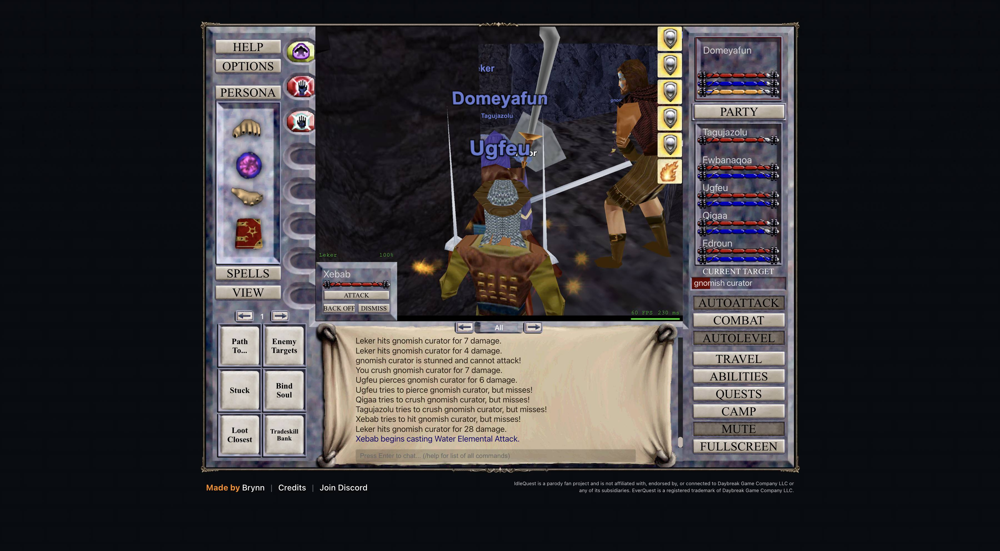

# 2026-11-08 (night): raid mode in the client, roster corrections, model-ranked zones and the first errand

Domeyafun is level 31 (82%), Tagujazolu 32, Ewbanaqoa, Ugfeu and Edroun 31, and Qigaa 30. The party hunts in Solusek's Eye at about 2.4M XP per hour per character. The spread matches the wiki's XP factors: Tagujazolu is a Dwarf Warrior (0.90) and Qigaa a Barbarian Shaman (1.05).

## Raid mode, read from the client

- Raid fights start from whatever NPC above level 50 the leader targets in the current zone, with AutoLevel off, so every raid fight is commanded (`Vd`, `.re/js/main.pretty.js:50654-50656`).
- Recruits join as snapshots of real characters, with their gear, skills, AAs and scribed spells, and cost nothing. The client has no member limit, and nothing reads the per-target budgets or class costs it carries.
- Recruits give raid buffs from the spells they have scribed, and copies do not stack. Only the leader adds its class's generated package, so a Wizard leader gives every member a 700-point Spellshield rune.
- Raid time costs platinum per hour for the whole account, priced by its highest-level character. Bosses come from their own spawns, the server's daily boss list (two free resets per rolling 24 hours) or casino potions. The casino table has Yelinak, Vulak`Aerr, the Avatar of War, Tunare and the four Warders, but not Vyemm, Cazic-Thule or Kerafyrm.
- Kerafyrm's rows are untargetable and his quest scripts are empty files, so the roster is no longer sized for him.

## Roster corrections

- The first rewrite of the roster plan claimed budget tiers for the Velious bosses, a class package for every recruit, a Necromancer mana transfer and a free Cleric resurrection. None of these has a source in the client. `115fc5d` corrected the plan, recorded how the roster was chosen and added the events that should trigger a re-plan.
- The plan also had a Magician lead each group because the bot's spell upkeep knows only Magician spells, and listed epics after the Magician's. Both treated Domeyafun as special. `49cd107` removed them: a bot limit is a bot task, and the damage slots stay open until the raid engine's caster model has been compared.
- Seven agents now audit the guide, README and agent rules, the client internals, the leveling, systems, epic and roster plans, the code's hard-coded assumptions, and a spell upkeep that works for every class.

## Zones ranked by the model

- At levels 31 to 36, `tools/predict.mjs` ranks Solusek's Eye (2.5M to 2.65M XP per hour) and Splitpaw (2.3M to 2.45M) first. The old rows sent the party to Crystal Caverns and Frozen Shadow (1.7M to 2.0M) and Kaesora (1.0M), where 63 to 79% of the in-band mobs are immune to melee. `c8cfb63` moved the level 31 and 34 rows to Solusek's Eye, Splitpaw and then Dalnir or Droga.

## First errand: Power of Water

- `iq.errand` (`608cebe`) moves the party to a zone, keeps every enemy except the named ones on AutoLevel's skip list, holds the rotation and the empty-zone handling, and rotates on once the item is in the bags or a deadline passes.
- In Kaesora it pulled an enraged ravener and got Power of Water in about six minutes, then moved to Solusek's Eye on its own.
- Epic pieces in the bags: Heart of Frost (Warrior), Torn Page of Magi`kot pg. 2 and Power of Water (Magician).
- The snapshot's drop tables give the other Powers: Fire at 2% from blazing elementals and 28% from the rare lava elemental in Solusek's Eye, Wind at 100% from Mistmoore's gypsy dancer, and Earth at 11.6 to 16.5% from Lesser Faydark's faerie and fairy guards.

## Level 31

- Level 31 needed 3,070,100 XP (`1.1 * 1000 * 31^3` minus `1.1 * 1000 * 30^3`), a normal step again after level 30's jump.
