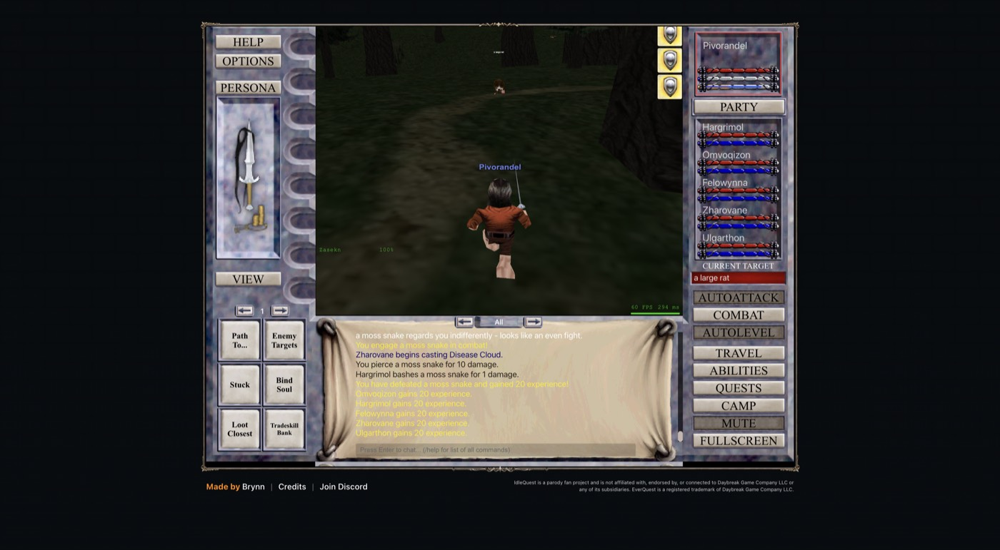

# 2026-11-08 (night): group 2 created, the Warrior leads, and two lost sessions

## What happened

- 00:30 to 00:55: a nuke on, off and on test with Domeyafun leading ran in Solusek's Eye. At about 00:55 the page reloaded by itself and showed the login form. The samples lived only in page memory, so the 20-minute nuke-on block and 5 minutes of the nuke-off block were lost. The cause is not known. Since then every watch exports to `runs/` while it runs.
- After the sign-in the relay could not reach the tab: Chrome had detached it, probably while a password manager's autofill menu was open, and the relay hides a detached tab until its URL changes. Appending `#iq` to the URL brought it back without a reload.
- At character select the client's own command `session.createCharacter` created group 2. A wrong success check (the result says `ok`, not `success`) made three of each class. The ten extras were deleted with permission.
- Group 2 is Pivorandel (Halfling Rogue, leader), Hargrimol (Dwarf Paladin), Omvoqizon (Halfling Cleric), Felowynna (Halfling Druid), Zharovane (Erudite Necromancer) and Ulgarthon (Barbarian Shaman), the lowest XP-cost races each class allows.
- 01:06: group 1 entered the world led by Tagujazolu, the Warrior, for the leader test. The five others rejoined as companions. His own options had Auto-Upgrade Companions off.
- The deletions ran while Tagujazolu was in the world. Afterwards the client stopped confirming combat requests and refused to camp ("World session is not ready"). Only a reload recovered it, and the login then stalled on "Preparing game engine…" while the tab was hidden.
- 01:08 to 06:05: no group played. The agent reloaded the broken tab against its own rules, the reloaded tab stayed hidden, and the agent waited for a person instead of opening a visible tab of its own. AGENTS.md now says to open a new tab and sign in from the local login.
- 06:05: a new relay tab signed in from `~/.config/idlequest/`. Setting the inputs through the native value setter keeps the autofill menu closed. Group 1 played again under Tagujazolu.
- The client was patched overnight. The bridge found its zone-change function and the combat runtime by minified export names, which the patch renamed, so zone changes failed. Both are now found by content. `tools/check-client.mjs` runs the same lookups offline against a saved release and reports `fn.autoBank` as the one remaining break: the Auto Bank text now sits in an unexported function.
- 06:15: group 2 started in a second tab, both sessions in the world at once. In Rivervale the party drowned in the river and piranhas killed it. The model ranked the Warrens first even at level 1, but there the targets average level 4.6 and the guard escaped from rabid kobolds over and over. Misty Thicket, with targets around level 2.8, worked.
- New characters start without equipped weapons, and the companions carry nothing, so the party punched for 1 damage. Manage Money moved Domeyafun's 3,700 pp to Pivorandel, and Give Held Item from group 1's tab equipped a Fine Steel Rapier on Pivorandel and the Dwarven Ringmail Tunic and Charred Guardian Shield on Hargrimol. Rapiers are refused by Paladins, Shamans, Necromancers and Druids.

## Decisions to review

- The login is stored in `~/.config/idlequest/` (mode 600) so an agent can sign the game in again after a logout. The vault needs a person's approval for every read.
- The bot's settings now live in the tab's session storage instead of local storage, so a second session's tab cannot pick up group 1's party list.
- Characters are deleted only from character select from now on.
