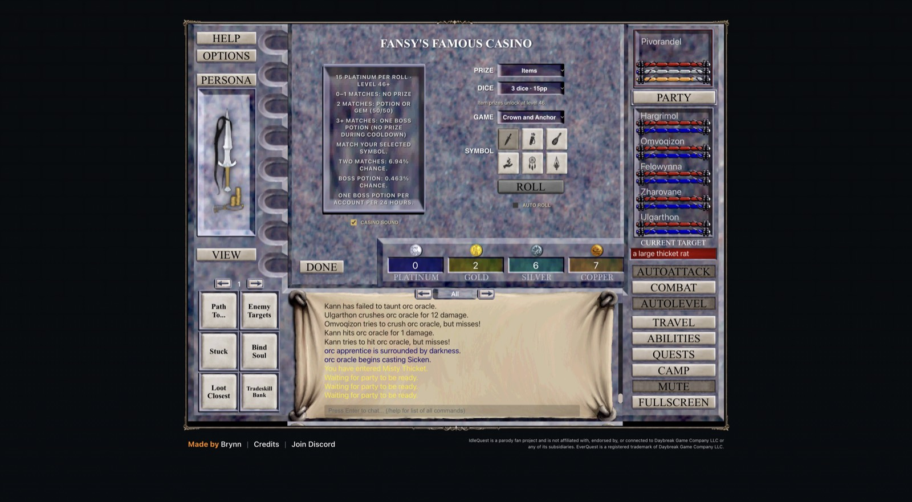

# 2026-11-08 (morning): a crashed tab, the casino, group 4 on hold and a simulator on real data

## What happened

- Group 3 shopped in West Freeport for weapons. The bot pulled the party back toward its rotation once before it was disabled, a zone load failed and came back with TRY AGAIN, and on the way back to Misty Thicket the tab crashed. A new relay tab signed in from the local login, entered as Tovrenalis and took the five companions back. Group 3 hunted again about four minutes later.
- 07:12 to 07:35: Domeyafun's nukes were off while Tagujazolu led group 1 in Solusek's Eye. Recovery fell from 21% to 7.5% of the time, but kills took 23 s instead of 17.7 s and XP per hour was 2.86M against 3.00M with the nukes on. That is inside the block noise, so the nukes stay on.
- 07:37: Tagujazolu reached level 35.
- Fansy's Famous Casino (`/casino`) answers how casino boss potions are won. From level 46 its Items prize plays Crown and Anchor with 3, 6 or 9 dice for 15, 210 or 600 pp. Three matches win a boss potion, at most one per account per 24 hours, for about 3,300 pp on average at every dice count. That gives a third boss a day next to the two free resets. No Double Experience potion is among the prizes.
- The patched client renamed three zones to their classic short names (`tox`, `steamfont`, `oot`), and the bot's move to `toxxulia` failed. The band rows, the zone model and the gear tool now use the live client's zone list.
- Zharovane, Zulvethra and Fizzwackle had fought with empty hands or Fire Beetle Eyes while their starter daggers sat in their bags. Each now holds his dagger.
- 08:05: group 4 was created at character select in a fourth tab (Thalgrimm, Pellisande, Merriwick, Kragvold, Vorthessa, Nyxalor), with races picked by XP cost. It was a mistake to create it before the simulator could judge races and roster size, and the races ignored everything but leveling speed. The group is parked at level 1 with its bot off.
- The simulator had given every member remembered attributes and skill caps. It now takes the creation stats of each race and class from the live client and the skill caps for levels 46 to 60 from the server. Groups 1 to 3 need 712 s for Hraashna on real numbers instead of 459 s.
- With real stats, 36 characters at level 60 in merchant gear fail Tunare in every simulated fight and leave 9 to 13% of her health, whatever race the Warriors, Clerics, Shamans or Necromancers have. Race is not what decides raid strength. Gear, healing and roster size are.
- A guild of our own characters would change nothing in raids, so none was created.

## Decisions to review

- A boss potion costs about as much as group 1 earns in five to eight hours. Whether to buy one each day depends on the raid-time price, which is still unknown until a character reaches 46.
- Group 4's classes and races wait for simulator runs with farmable gear and for the roster-size sweep. Recreating its six level-1 characters needs a deletion, which needs a person's approval.
- Supervision moves from hand-written checks to a collector process with a database and attention rules (`iqd`), built in its own worktree.
