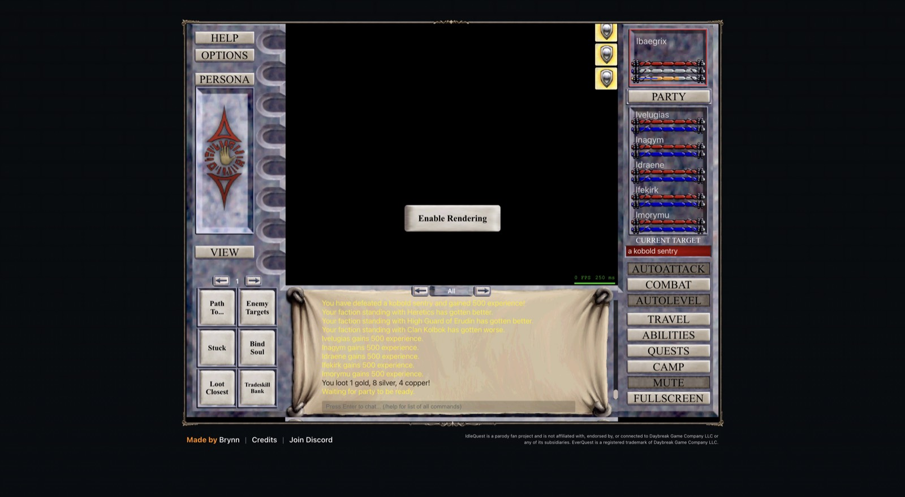

# 2026-11-08 (midday): all 72 characters exist, and twelve groups level at once

## What happened

- The roster plan settled on 72 characters in twelve groups of six, balanced across the classes (4 to 8 of each, 8 Clerics and 8 Shamans) with a tank, a healer, a slower and damage in every group. Simulated level-60 fights with farmable gear kill all five bosses with this roster. A roster of 19 Shamans and 20 Necromancers is about twice as fast on Vulak`Aerr and the Avatar of War, which is the price of the balance ([raid roster](../docs/plans/raid-roster.md)).
- Group 5 was set up by hand and went badly. A travel call kept opening and closing the Travel window because it only matched long zone names, Embrogg died twice (once while AutoLevel was paused mid-fight, once in the Feerrott, a zone no measurement supported), and nothing respawned the dead leader. Travel now teleports with the zone-change request, the bot takes the free respawn and moves a group back into its rotation, and a second guard escape within 30 seconds leaves for another zone, because a goblin shaman camping Misty Thicket's zone-in had re-entered the party into the same fight every six seconds.
- `createGroup` (`src/group.mjs`) now does the whole bring-up from `data/roster.json`: sign-in, six characters with the race whose creation stats suit each class, starter weapons, packed bags and five to seven Backpacks each, options, tactics and AutoLevel. Groups 6 to 12 came up in six to nine minutes each between 11:30 and 12:45, so all 72 characters exist.
- With seven groups in Misty Thicket and Toxxulia Forest, the client gave up targets "already engaged by another player" and sometimes stopped AutoLevel. Each bot now writes its zone to the browser's shared storage and picks the zone fewest other tabs hunt, and it restarts AutoLevel at once after such a stop. Greater Faydark joined the rotation from level 5, after level 12 lesser mummies at its zone-in chased two level 2 groups out.
- Two measurements settled ideas from the morning. Turning the Necromancers' DoTs and nukes off in four groups for 26 minutes each cut the recovery share in all four (21 to 25% on, 16 to 22% off), but XP per hour moved with zone changes, deaths and level-ups, so the default stays. A level 2 Wizard in group 1's level 36 to 38 party received no XP on 4 kills, so a high group cannot carry new characters.
- Inventory Search answers what every character carries, banks and wears. A survey of all 72 characters found 436 items and only 13 hand-me-downs worth 6 to 26 points, so the account has little spare gear yet.
- `restoreGroup` brings a crashed group back in a new tab in about half a minute and was tried on group 12.

`tools/groups.mjs --last 30` at 12:58:

| Group | Level | Mix | Zone | XP/h | Moving | Deaths |
| --- | ---: | --- | --- | ---: | ---: | ---: |
| G1 | 38 | War Mag Clr Brd Shm Enc | Solusek's Eye | 3.95M | 13% | 0 |
| G2 | 10 | Rog Pal Clr Dru Nec Shm | The Warrens | 446k | 20% | 0 |
| G3 | 7 | Mnk SK Clr Nec Wiz Rng | Misty Thicket | 88k | 44% | 9 |
| G4 | 5 | War Clr Clr Shm Nec Nec | Misty Thicket | 58k | 40% | 0 |
| G5 | 4 | War Clr Shm Nec Enc Rog | Toxxulia Forest | 48k | 40% | 1 |
| G6 | 4 | Mnk Pal Dru Shm Mag Wiz | Toxxulia Forest | 55k | 37% | 2 |
| G7 | 3 | SK Clr Shm Brd Rng Nec | Toxxulia Forest | 35k | 36% | 1 |
| G8 | 3 | War Dru Enc Rog Wiz Mag | Toxxulia Forest | 33k | 40% | 3 |
| G9 | 3 | Mnk Pal Clr Shm Brd Rng | Toxxulia Forest | 33k | 45% | 2 |
| G10 | 2 | SK Dru Enc Nec Wiz Brd | Toxxulia Forest | 15k | 35% | 3 |
| G11 | 3 | War Pal Shm Rog Rng Mnk | Misty Thicket | 23k | 46% | 1 |
| G12 | 2 | SK Dru Enc Mag Brd Rng | Toxxulia Forest | 7k | 34% | 0 |

## Decisions to review

- Groups below level 8 spend 35 to 46% of their time walking and wait most for a caster's mana. Which lever pays at these levels, zones with denser targets or tactics, is open.
- Group 3 died 9 times in 30 minutes in Misty Thicket at level 7. Its zone and limits need a look.
- Hand-me-downs wait until group 1 outgrows more gear. The plan tool and the account survey are ready for that.
