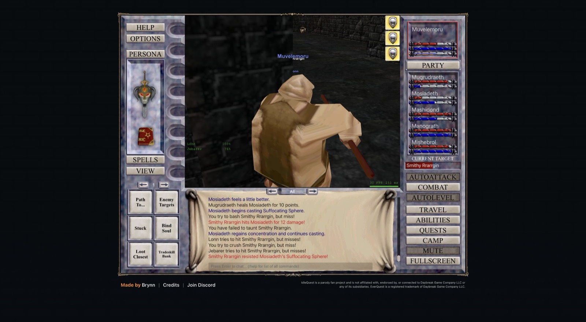
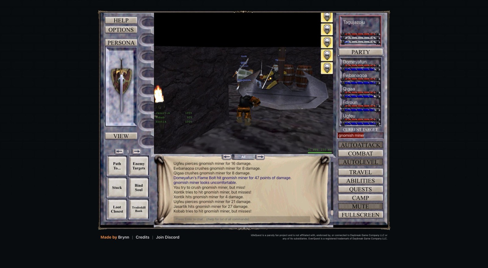

# 2026-11-08 (afternoon): the guard rebuilt on evidence, deaths cost XP, a controller instead of patches

## What happened

- The guard's fixed rule (leave when any engaged mob is 8 levels above the leader) was replaced by rules that rest on the fight logs. `tools/fights.mjs` split every recorded run into 6,497 fights. Of 606 level escapes, 441 left before any combat line, while deaths came from fights against mobs that did hit someone from 4 to 7 levels up. A recorder in eleven tabs then showed why so many escapes looked pointless: Toxxulia's Erudin emissaries and Sentinel Creot and the level 50 guards of the Greater Faydark were fighting other NPCs (target `npc:<id>`), and goblin shamans stood idle with no target. The guard now counts only mobs whose target, chase or hate names the party, uses a gap of 6 for those up to leader level 8, and leaves when the leader is at half HP or less and would be dead within 4 s at the HP lost over the last 6 s. In the recorded fights that last rule fired before 24 of 27 leader deaths.
- The crossover of that package against the old guard (two 45-minute blocks, eight groups at levels 5 to 8) measured 0.33 fewer leader deaths per hour (-0.80 to +0.14), 1.2 fewer deaths of anyone (-3.0 to +0.6), 0.8 more escapes and XP per hour -1% (-15% to +15%). Nothing is significant, but every death figure points the same way, so the package stays. The crossover's in-page timers had left half the tabs on the old settings, because each install of the bridge copied the whole guard config. Now only settings changed by hand carry over, and every tab runs the defaults.
- Deaths are not free. The client no longer has a Death XP Loss option, and from level 5 a leader's death costs level squared times 666.67 XP ("You lose 16666 experience." at 5, a lost level at 5 and at 6), about 10 to 17 minutes of the group's XP at any level. Companions showed no loss in 51 deaths. The Resurrection window sells 50% of the loss back for 50pp and 90% for 200pp and puts the leader back at the corpse, so the bot now buys the best one the leader can pay above a 100pp reserve.
- Lightstones are the strongest leveling lever below level 20. Smith Tv`ysa in South Ro gives 274,400 XP for a Greater Lightstone and 137,200 for a Lightstone, without a repeat limit, only to the character that hands it in. One stone took group 8's leader from level 5 to 8.
- Six hours of eleven groups at levels 4 to 6 measured Steamfont at 101k XP/h and Nektulos at 83k against Misty Thicket at 70k, Toxxulia at 49k and the Greater Faydark at 47k, so the rows below 8 are now Steamfont, Nektulos and Misty Thicket. Najena joined the rows from 14 to 21 for the Magician's four Torn Pages of Mastery.
- Three leaders had no coin for their companions' spells. Passing the 3,400pp hub through them bought 21 spells for about 13pp.
- The midday entry's death counts included pets and the bot's own repeats of each death. `tools/groups.mjs` now counts each party death once and shows leader deaths and the XP they cost.
- Group 1 stood idle during a lightstone errand, and stone rounds run from a script left groups on a companion or in South Ro when the script died. Each had been answered with one more rule, and about fifteen overlapping detectors and timers had piled up. `docs/plans/controller.md` now sets the design the bot moves to: every tab converges to a desired state, hunting is the default, every second carries a label, a pause is a lease, multi-step work runs in the page, and decisions compare value per hour. Three steps are live on every group:
  - Every recorded second carries a label from the client's own state (fight, approach, recover, travel, task, dead, idle with a cause). Over 45 minutes the twelve groups were idle 0% to 7% of the time, mostly in AutoLevel's 5 s pause after each kill with the party already full. Moving (9% to 46%) and recovering (8% to 34%) cost far more. One stall alert in the collector replaced two: idle or dead for 2 minutes, or no kill for 5, in any mode but a pause or a raid.
  - Each tab has a leader setting. When a pause ends, also because its script died, the bot camps and enters the world as the leader with the client's own commands (about 4 s), regroups, moves back into its rotation and restarts AutoLevel at once.
  - A hand-in runs as a task in the page. Group 3's members handed in their own 4 Greater Lightstones (levels 9 to 11 became 11 to 13), and group 12 pulled 9 from groups 1 and 2 and handed them in for all six members in 340 s, 2,469,600 XP, levels 6 to 8 and 9. Fifteen seconds after the task the group hunted in the Warrens with its full party.
- The live runs found three faults that the old flows had hidden: camping restarts the chat's message numbers, so the bridge stopped recording chat after any character switch; the guard restarted AutoLevel after an escape even while a script held the party; and the bot moved a party out of South Ro during a long hand-in because its zone rule ignored pauses. All three are fixed.

## Decisions to review

- All 13 Greater Lightstones on the account went to groups 3 and 12. New stones come only from wisps in Nektulos, where groups 5 and 7 hunt, so the next step is to count the stones they loot per hour and hand each stock to the slowest groups.
- Group 1's gray wisp farm stopped: it cost group 1 about 3M XP/h for 148 kills an hour, and the low groups in Nektulos competed for the same wisps.
