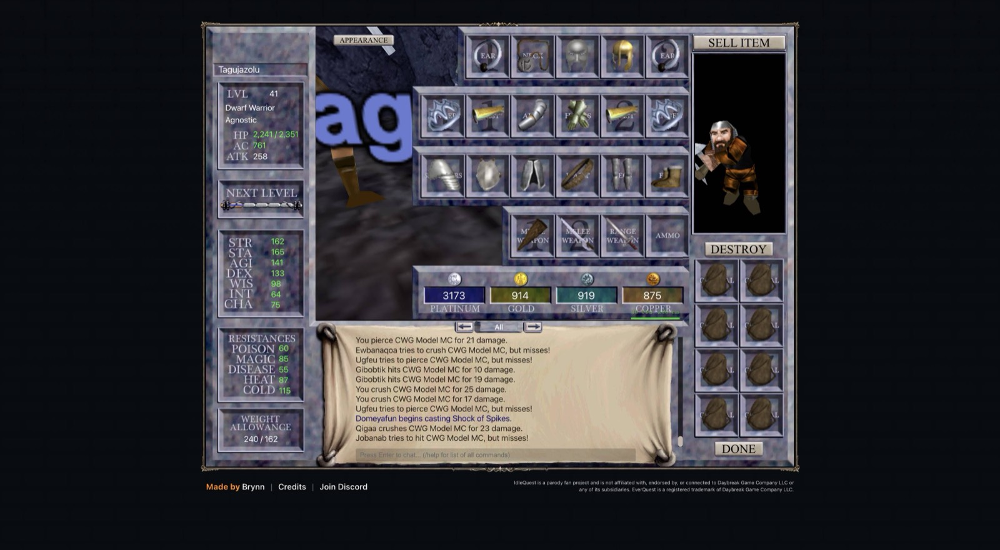

# 2026-11-08 (night): a coordinator, camps on spawn points, and NO DROP pieces that move

## What happened

- The collector got a coordinator. `iqd run --coordinate` reads every tab each pass and queues tasks through the bots' own task API: lightstone hand-ins for the free group with the lowest levels, directed hunts and errands for epic pieces from `data/opportunities.json`. Its policy is a pure function with tests (`tools/lib/coordinator.mjs`). It handed 19 stones to group 7, 15 to group 4 and 12 each to groups 5, 9 and 11, and it sent group 2 on an errand in Najena that took Torn Page of Mastery Fire.
- Hunts for rare spawns now use the client's own Spawn Camp on the enemies' spawn points, at minimum con green so that placeholders die too. A camp ends once every point waits and reports the first respawn, and the coordinator comes back then. Group 1's camps for Magi`kot page 3 in Lower Guk and for Lord Gimblox in Solusek's Eye each took seconds and came back with the next spawn time. A tab spends at most 15% of an hour on such hunts until a value model weighs a piece against the XP it costs.
- NO DROP pieces move between the account's characters. Inventory Search's Transfer pulled Power of Water from Tagujazolu to Pivorandel while Tagujazolu led group 1 in another tab. Hunts therefore no longer switch to the character who needs the piece: the leader loots, and the hand-in pulls the piece to whoever turns it in. That deleted the looter switch and the regroup it needed.
- Idle handling is one table keyed by the activity label's cause, with rungs restart, widen, move and alert. It replaced three watchers. A party that loses members during a fight stops pulling and rejoins them, because the client refuses party adds in combat.
- `iqd run --recover` reinstalls the bridge and bot in a tab that lost them, and signs in with the stored login at the login form. With group 9's bot removed, it was back with its leader and party within two minutes.
- The dashboard at http://127.0.0.1:4790/ shows each group, its task and the coordinator's history on a local 24-hour clock.
- `tools/gear.mjs --list` reads 385 items of the P99 pre-raid list, 244 of them with a drop source in the content data, as candidates by class and slot, because the gear score alone favours raid drops.

## Measured

Over the three hours to 19:10, by the activity labels in the recorder samples, the twelve groups spent 46% of their time fighting, 23% recovering, 22% walking to enemies and 6% idle. Waiting for enemies other groups held was 4%, and three quarters of that happened with another of the account's groups in the same zone.

Groups with a Necromancer recovered for 18 to 34% of their time, groups without one for 13 to 18%. In those groups the Necromancer's mana was the last bar to fill in 68 to 93% of the recovery seconds. Groups 2, 5 and 7 now play with their Necromancer's nukes off and DoTs on, against groups 3, 4 and 10 as the control, read after two hours.

The level 11 and 14 band rows gained Guk and Najena, because nine groups at 11 to 13 shared four zones, two per zone, and the model puts both new zones level with Befallen and Crushbone.

## Next

- Read the remedy table's effect on idle time, and the Necromancer experiment.
- Tanks: test a shield against an off-hand weapon. Three of four warriors carry shields by chance, and one carries a rod that adds nothing.
- A planner for hours to level 60 per group, so the coordinator can weigh hunts, stones and zones by what they save on the critical path.
