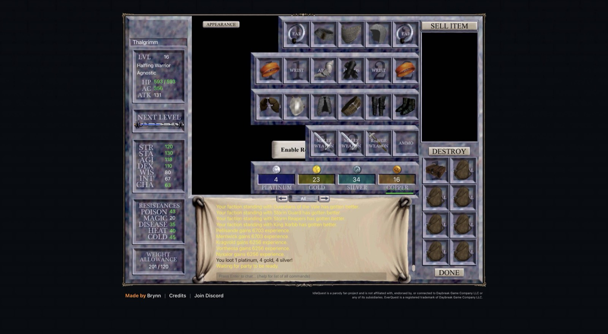

# 2026-11-08 (late): quests, gear and experiments become coordinator work

## What happened

- The hand-in task became a general quest task: per member it travels, pulls what a step hands over from any account character, talks with keywords, gives items or hands them in, and checks the reward. The coordinator runs every chain in `data/quests.json` for each character of the chain's class who lacks the reward. Tagujazolu, Thalgrimm, Loshotin and Embrogg finished the first Warrior chain (Kargek, Oknoggin, Kargek, Tenal) with the Totem of the Freezing War, and Ugfeu ran the Bard torch relay to Maestro's Symphony Page 24 Top.
- A task now survives a reinstall: the bridge stops an older install's jobs and the bot resumes the task from its progress. NPC walks time out only without movement, so the 7,000-unit walk to Tenal Redblade in East Karana no longer fails.
- Group 1's camp took Lord Bergurgle's Crown, the first step of the Cleric epic.
- Gear became a coordinator pass. Every hour it reads every party's worn items and the leaders' bags from the parties' own inventories, the companions' carried items from Inventory Search, and gives each carried item to the character and slot where it adds most. The first pass covered 2,465 items, and a gear task in group 4's tab carried out 36 of 37 moves for 34 characters without switching characters. Items that are an upgrade for anyone are never sold. Auto-Upgrade and Auto-Upgrade Companions are off on every character, because they equip only within the looting party and never move an item again.
- Experiments became data. `data/experiments.json` holds two-period crossovers, and the coordinator sets each arm's bot settings, swaps them, keeps the groups off farms and errands, and registers the crossover command at the end. The first compares a white minimum con with blue in eight groups from 21:17.
- iqd deploys changed bridge and bot code to every tab by itself, and the attention list closes items the tabs show to be over.

## Measured

- Idle time of the hunting groups fell from 7.6% to 2.3% in the two hours after the remedy table went live, with only five remedies acting, so the wider zone rows share the credit.
- Necromancer nukes off in groups 2, 5 and 7 did not shorten their recovery: the Necromancer still held 2,100 to 2,300 seconds of each group's wait. The spend is the DoTs.
- A companion death costs about 38 seconds beyond a kill and a leader death 85 seconds plus its lost XP (`tools/fights.mjs`), so the deaths alert now wakes by that cost, not by a count.

## Next

- Group 1 reaches 46 in about 11 hours: the first raid, the daily boss list, the raid price and the AA catalog.
- Read the minimum con crossover when its job appears, about 00:20.
- More quest chains in `data/quests.json`, and a coin plan for raid days.
