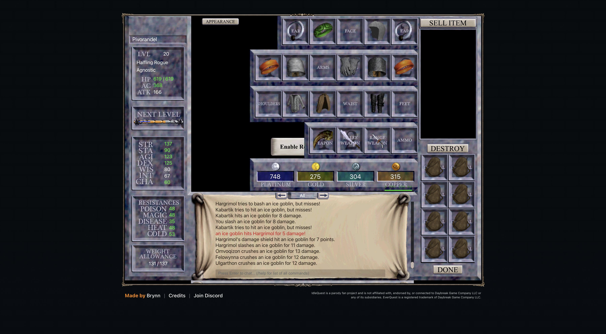

# 2026-11-08 (night): quest fights, the first Cleric attempt and zones by measured rates

## What happened

- Quest steps can now fight. A step names an enemy to `kill`, the quest task gathers the group around the member it runs as, because a member other than the leader enters the world alone, and it fights the enemy once it is up. A quest that hands over a dropped item runs only for as many members as the account holds copies, plus members already part way through.
- The first Cleric chain ran for Ewbanaqoa with group 1's Lord Bergurgle's Crown. Shmendrik took the crown and Natasha spawned, all five members joined, the party killed Shmendrik, and the spirit of flame spawned at his corpse and attacked. The fight stopped at about half of the spirit's 3,300 hp: the client logged nothing for 34 seconds, no kill line, no loot, and the spirit was gone. The task failed when its window ran out. The next crown repeats the attempt, and its failure message now records the combat state. Shmendrik also dropped a Plasmatic Priest Robe, chest armor for the gear pass.
- The Necromancer's first step is data: a hunt for Sir Edwin Motte's head in East Freeport for groups of 30 and up, and a quest that gives each head to Kazen Fecae.
- The Mastery page errands in Najena now go to groups of 17 and up, after three ended early at 13 to 15 with guard escapes and a leader death.
- The wisp farms take groups of 10 to 13 only, where stones beat hunting, and a third farming group goes to the willowisps of the Northern Plains of Karana.
- The coordinator assigns zones. iqd keeps XP per hour by zone and leader level from the samples of groups hunting alone outside tasks and errands, and every five minutes each free group gets the three best zones of its band row, a crowded zone counting for less. The band change at level-up and the zone counts in the browser's shared storage are gone. The first pass moved group 2 from Najena to Permafrost and sent group 6 to try Najena.
- Double Experience is out of the plans: its potion is a reward for bug reports, not obtainable in normal play.

## Measured

- Zone rates of groups 2 to 12 at levels 11 to 14: Kurn's Tower 519k, the Warrens 530k, Befallen 501k, Runnyeye 414k, Crushbone 286k, Steamfont 172k. At 15 to 24: Kurn's Tower 783k, Runnyeye 604k, the Warrens 580k, Najena 422k (`tools/calibrate.mjs`). The model is off by 77% for these groups at 15 to 24.
- Recovery takes 19 to 47% of the low groups' time. Sitting does not change regeneration, leaders never starve (the server feeds them from 16 to 43 carried meals and drinks), and groups 10 and 12 already hold Breeze on every companion and recover as much as the others.

## Next

- The minimum con crossover ends at 00:17, and its job reads the result.
- The stones change waits for its live check: the next batch should go to group 8 while it farms.
- Watch the zone passes: whether groups settle, and how fast the thin zones gather measured time.
